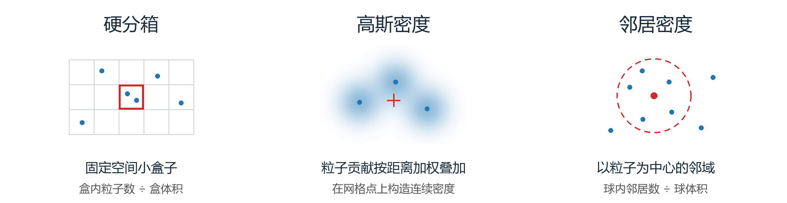
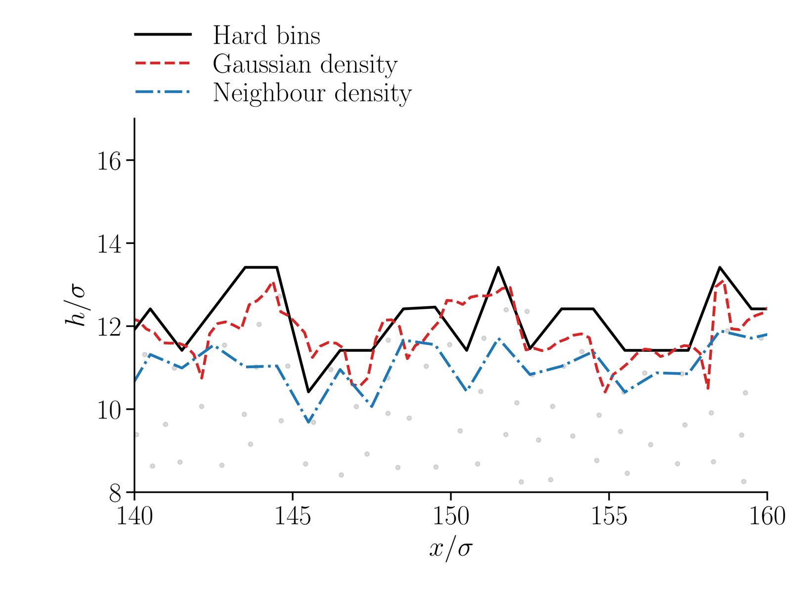

# InterfExtractMD

从MD粒子坐标重建液气界面，用同一构型比较**硬分箱、高斯密度和邻居密度**。仓库提供三种方法的实现、截面对照和可运行示例，便于选择适合自己分析目标的界面定义。

## 三种方法，三种观察方式



| 方法 | 密度在哪里计算 | 如何形成界面 | 适用场景 |
|---|---|---|---|
| **硬分箱** | 固定三维小盒子 | 粒子计数形成密度，再取阈值等值面 | 密度分布、粗尺度表面、分箱与采样分析 |
| **高斯密度** | 固定空间网格点 | 粒子贡献按距离加权叠加，再取阈值等值面 | 连续界面、短波起伏、时间平均效果 |
| **邻居密度** | 每个粒子的中心 | 先识别液体粒子，再取横向箱内最高的液体粒子 | 液体粒子识别、局部结构、粒子尺度表面 |

## 同一截面，直接比较



图中三条曲线取自同一条 **300σ × 300σ二聚体液膜**轨迹的同一瞬时帧、同一物理截面：黑线为硬分箱，红线为高斯密度，蓝线为邻居密度取面。灰点是粒子在薄层中的投影，密度计算和邻居计数使用完整的三维流体粒子构型。

硬分箱保留明显的局部起伏，高斯密度给出更平顺的轮廓，邻居法呈现粒子尺度的表面结构。三条曲线保留各自的绝对高度，直观展示不同界面定义得到的位置和形态。

[查看更宽的截面](docs/assets/interface_wide.png)

<details>
<summary>截面对照的参数</summary>

| 项目 | 设置 |
|---|---|
| 硬分箱 | 盒体积 $1\sigma^3$，横向300 × 300 |
| 高斯密度 | $\xi=\sigma/\sqrt{20}$；横向间距0.25σ，竖向间距0.125σ |
| 两种密度等值面 | $\rho_c=\rho_{\mathrm{bulk}}/10$，沿实际线性交点取连续主液膜分支 |
| 邻居密度 | $r_c=3.5\sigma$；$\rho_i>0.415\sigma^{-3}$；横向箱1σ × 1σ |
| 截面 | $y=150.5\sigma$；图中 $x=140$–$160\sigma$ |
| 时间处理 | 三种方法均为同一瞬时构型 |

</details>

## 方法原理

### 硬分箱

将空间划成小盒子，每个粒子按其中心位置计入一个盒子。局部数密度为

$$\rho_B(t)=N_B(t)/V_B.$$

沿竖直方向对密度作分段线性插值，取液体侧向气体侧的阈值交点。时间平均时，先累计各帧密度，再提取界面；盒尺寸和观察窗口共同确定密度的采样尺度。

### 高斯密度

每个粒子向附近网格点贡献连续权重：

$$\rho_\xi(\mathbf r,t)=\sum_i W_\xi(\mathbf r-\mathbf r_i(t)),\qquad W_\xi\propto\exp[-|\mathbf r|^2/(2\xi^2)].$$

实现采用**直接粒子到网格的高斯加权**，每个截断核归一化后总贡献为一个粒子，再从密度场中提取阈值界面。核宽 $\xi$ 控制界面观测的空间尺度。

### 邻居密度

以粒子 $i$ 为中心，统计半径 $r_c$ 球内的邻居：

$$\rho_i=\frac{\#\{j\ne i:|\mathbf r_j-\mathbf r_i|_{\mathrm{PBC}}\le r_c\}}{4\pi r_c^3/3}.$$

将密度超过阈值的粒子标记为液体，再取各横向箱内最高液体粒子的坐标作为高度。计数使用三维周期最小镜像距离，排除中心自身，保留二聚体的键伙伴。示意图中的圆表示三维球形邻域。

## 快速开始

```bash
python -m pip install -r requirements.txt
python examples/synthetic_demo.py
python -m unittest discover -s tests -v
```

示例生成一片合成粒子液膜，依次运行三种方法，输出界面覆盖情况及功率归一化检查。README中的截面图展示真实MD构型，示例用于演示计算流程。

### 使用自己的粒子坐标

```python
import numpy as np
from interfextract import (
    hard_bin_density, gaussian_density, surface_from_density,
    neighbour_surface, power_spectrum,
)

# positions: 只含流体粒子的(N, 3)笛卡尔坐标，使用自己的数组。
box = np.array([[0., 12.], [0., 12.], [0., 20.]])
shape = (24, 24, 40)

rho_hard = hard_bin_density(positions, box, shape)
rho_gauss = gaussian_density(positions, box, shape, width=0.4)

h_hard, check_hard = surface_from_density(
    rho_hard, box, level=0.4, reference_height=9., branch="continuous")
h_gauss, check_gauss = surface_from_density(
    rho_gauss, box, level=0.4, reference_height=9., branch="continuous")
h_neighbour, check_neighbour = neighbour_surface(
    positions, box, shape[:2], radius=3.5, density_threshold=0.415)

if check_gauss["valid"]:
    power, qx, qy = power_spectrum(h_gauss, box)
```

输入为流体粒子的 `(N, 3)` 笛卡尔坐标数组。`box`使用 `[[xmin, xmax], [ymin, ymax], [zmin, zmax]]`，对应三向周期的正交盒。按自己的密度、长度单位和分辨率设置盒尺寸、网格与阈值。

### 时间平均

硬分箱和高斯方法均支持先平均密度，再提取界面：

```python
from interfextract import average_density

# frames按时间顺序逐帧提供positions；201帧覆盖一个闭合观察区间。
weights = [0.5] + [1.0] * 199 + [0.5]
rho_mean = average_density(
    frames, box, shape, method="gaussian", weights=weights, width=0.4)
h_mean_density, check = surface_from_density(
    rho_mean, box, level=0.4, reference_height=9., branch="continuous")
```

在上述二聚体液膜的单轨迹对照中，高斯密度经1τ平均后，$q\sigma=5$–$7$与$7$–$10$频段的功率相对瞬时结果分别降低约51%和59%，呈现出密度时间平均与界面提取共同带来的短波观测变化。

平均顺序决定所比较的量：平均密度后取面、平均高度后算谱、逐帧算谱后平均，分别保留不同的时间信息。

<details>
<summary>界面分支与功率谱约定</summary>

- 界面高度取自实际密度的线性阈值交点。无交点的列标记为NaN，`valid=True`表示通过完整界面检查，可进行FFT。
- `branch="continuous"`跟踪周期主液膜分支；`branch="nearest"`逐列选择最接近指定参考高度的实际向下交点。参考高度由调用者给定。
- 连续主液膜算法由本仓库实现。它保留主液膜的交点，并分别记录原始缺列与分支筛选后的覆盖情况。
- 功率采用减均值后的二维FFT每模幅值平方，并检查Parseval关系；环均谱使用每模平均。
- 高斯实现逐粒子直接求和。处理大网格时，按可用内存设置 `shape` 与 `max_cells`。

</details>

## 文件与数据

```text
interfextract/            三种密度定义、界面提取、时间平均与二维功率
examples/synthetic_demo.py  无需私有数据的演示
tests/                   质量、周期边界、真实交点、缺列和FFT检查
docs/assets/             方法示意图与已授权展示的截面图
```

仓库提供代码、说明与展示图；MD轨迹和场数据由使用者提供。示意图源码为 `examples/make_schematic.py`，绘制时需要Pillow与中文字体。

## 方法来源

- [Willis & Freund, *Physics of Fluids* **22**, 022002 (2010)](https://doi.org/10.1063/1.3326077)：分箱密度、时间平均与阈值界面。
- [Liu, Zhao, Lockerby & Sprittles, *Physical Review E* **107**, 015105 (2023)](https://doi.org/10.1103/PhysRevE.107.015105)：粒子邻居密度分类与最高液体粒子取面。
- 本仓库实现高斯密度观察与连续主液膜分支，并在同一粒子构型上比较三种界面。
